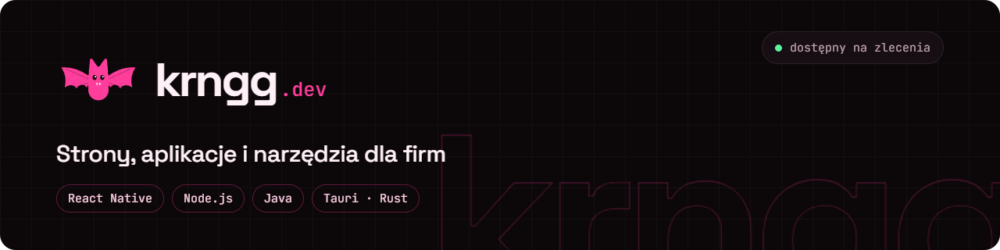
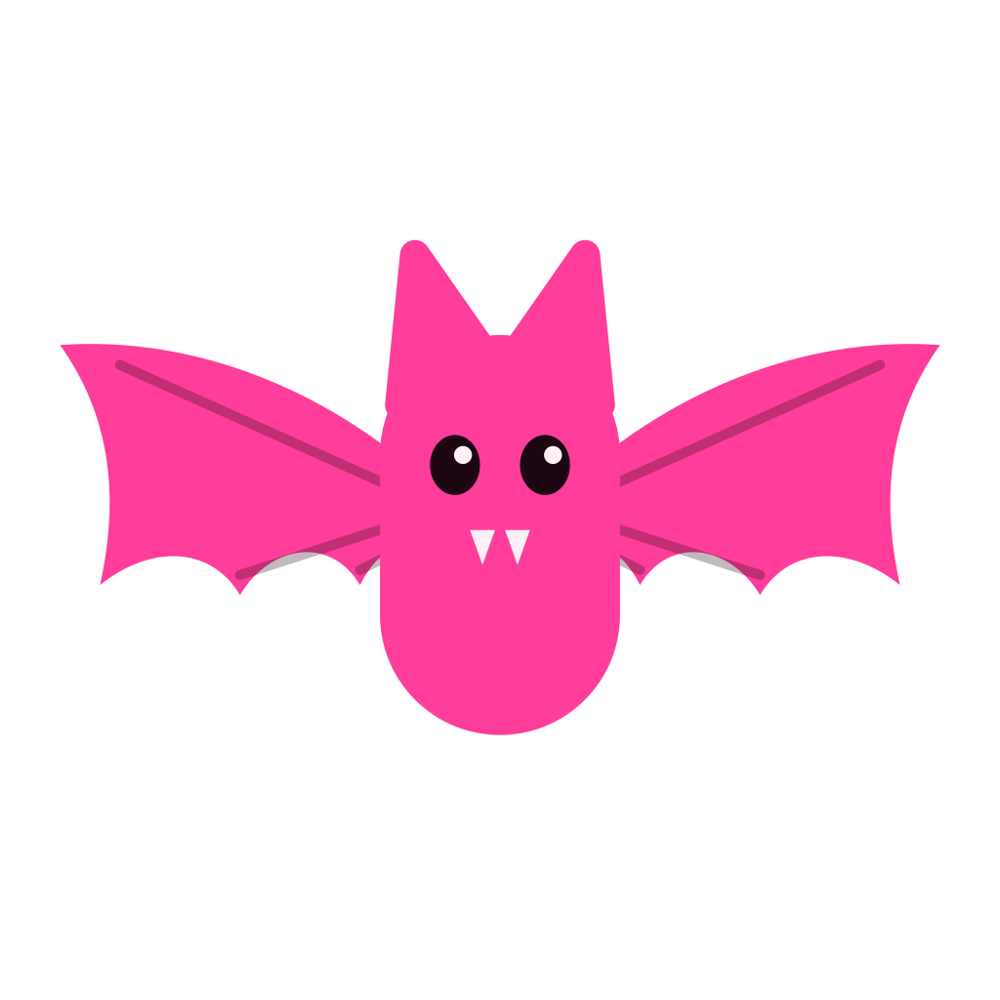

 

### Cześć, tu krngg

Buduję aplikacje mobilne, strony i narzędzia dla firm i społeczności: od projektu interfejsu, przez backend, po wdrożenie i aktualizacje. Lubię rzeczy, które ktoś faktycznie używa codziennie w pracy, a nie tylko demo.

 

### Stack

 

### Projekty

| | |
| --- | --- |
| **[solApp](https://github.com/k4rbon/SolDominium-APP)** | Prywatna aplikacja mobilna dla firmy SOL DOMINIUM: montaże PV, zdjęcia z GPS, magazyn, materiałówki i wyceny w PDF. Android i iOS. |
| **[krnBot](https://github.com/k4rbon/krnBot)** | Bot Discord z panelem www: tickety, moderacja, whitelista i blacklista, historia spraw. |
| **[Nexora Launcher](https://github.com/k4rbon/NexoraLauncher)** | Lekki launcher Minecraft dla kont premium, z własnymi aktualizacjami. Tauri, Rust i Svelte. |
| **[krngg.dev](https://krngg.dev)** | Moje portfolio zrobione w formie systemu operacyjnego. |

 

### Współpraca

Potrzebujesz aplikacji, strony albo bota dla swojej firmy lub społeczności? Napisz, czego potrzebujesz, a odezwę się z propozycją.

 

